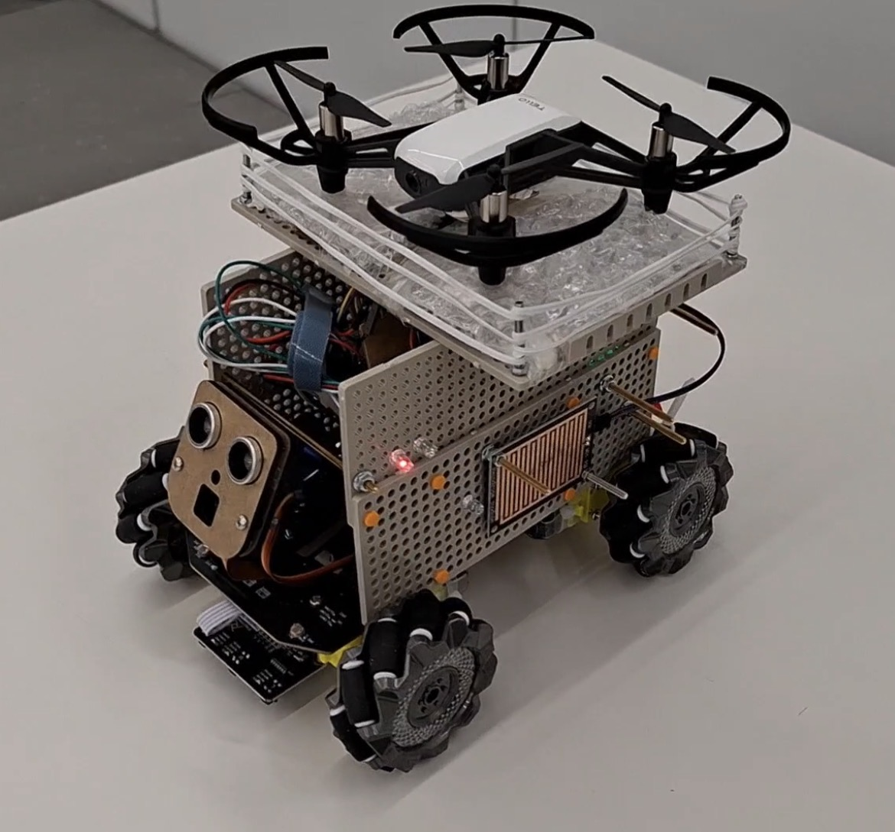
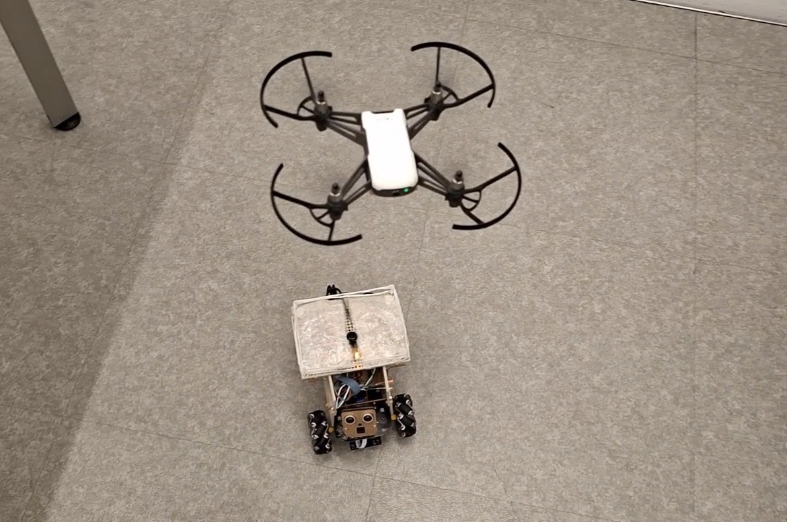
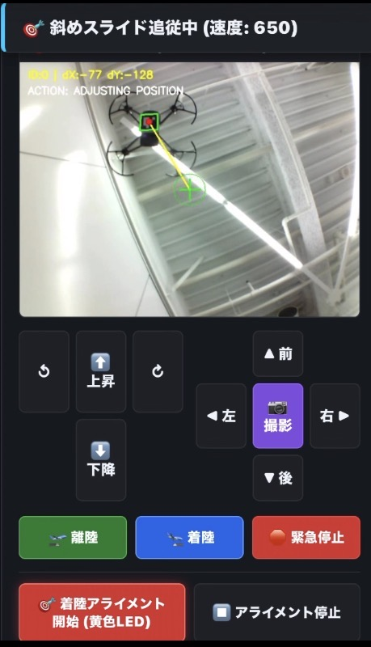
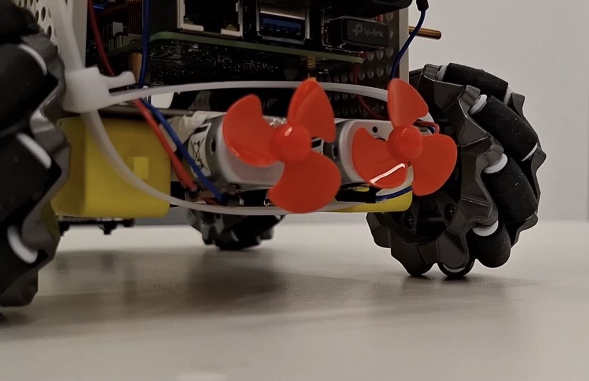

# Amphibious Land-Air Carrier Robot System
### "Interactive Entertainment: Land-Sea-Air Amphibious Carrier Robot"

[](README.md)
[](README.md)

[日本語ドキュメント (Japanese README)](README_ja.md)

> 🏆 **Honor**: Awarded the **"Faculty Award (教員賞)"** at the 2026 CCC competition hosted by IPUT Tokyo (International Professional University of Technology in Tokyo), competing across all project categories and entries.

<p align="center">
  
  
</p>

An integrated autonomous collaboration system coordinating land, sea, and aerial operations.  
Powered by a Raspberry Pi 5 core, this carrier platform combines omnidirectional mecanum wheel locomotion, dual-screw water propulsion, and a DJI Tello drone for synchronized aerial reconnaissance and automated deck landing.

---

## Key Features & Control Logic

- **Autonomous Deck Landing Alignment (Adaptive Speed & Dual Dead-Zone Control)**
  - Real-time ArUco marker tracking via an upward-facing deck USB camera.
  - Mitigates mecanum wheel physical friction disparities: maintains fixed velocity on longitudinal axes to prevent overshooting, while applying step-wise acceleration after 1-second stall detection on lateral/diagonal axes.
  - Transitions to pulse-width micro-stepping near the target center for pixel-level docking accuracy.

<p align="center">
  
</p>

- **Triple-Stream Teleoperation Dashboard**
  - Consolidates 3 concurrent video feeds into a single Web UI: forward CSI camera (surveillance/face recognition), deck USB camera (targeting HUD), and drone FPV camera.
  - Ultra-low latency command dispatching for omnidirectional drive, drone takeoff/landing, and independent capture triggering via Flask and WebSockets.

- **Edge Face Recognition & Attendance Logging**
  - Fast face detection and verification utilizing Haar Cascade and template matching.
  - Automated photo capture and CSV timestamp logging at 5-second intervals.

- **Hardware Safety & Fail-Safe Mechanisms**
  - Ultrasonic sensor forward-locking collision avoidance (50 cm threshold at high speed).
  - Water-level sensor trigger for automated twin-screw propulsion activation (Proof-of-Concept control logic; full waterproofing and water-borne tests are planned for future work).
  - Explicit GPIO resource release design tailored for the Raspberry Pi 5 (RP1) peripheral architecture.

<p align="center">
  
</p>

---

## Tech Stack & Hardware Components

- **Languages**: Python 3, HTML5 / JavaScript, Bash
- **Libraries**: OpenCV, Flask, djitellopy, lgpio, NumPy
- **Hardware Architecture**:
  - Main SBC: Raspberry Pi 5 (Raspberry Pi OS 64-bit)
  - Microcontroller: Raspberry Pi Pico
  - Chassis & Propulsion: Freenove 4WD Mecanum Wheel Car Kit, Torque-Tuned 2 Motors, Twin-Screw Marine Propellers
  - Aerial Node: DJI Tello Drone
  - Sensing & Imaging: Wide-angle CSI Camera, USB Deck Camera, Ultrasonic Distance Sensor, Water Contact Sensor

---

## Setup & Running

```bash
pip install -r requirements.txt
python3 server.py
```

Access the dashboard via `http://<RASPBERRY_PI_IP>:5000`.
